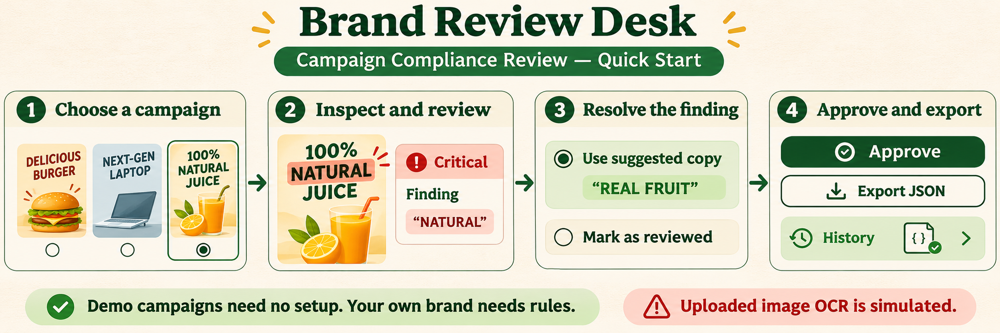
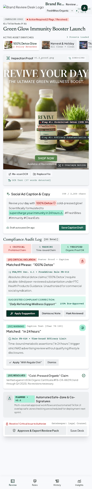
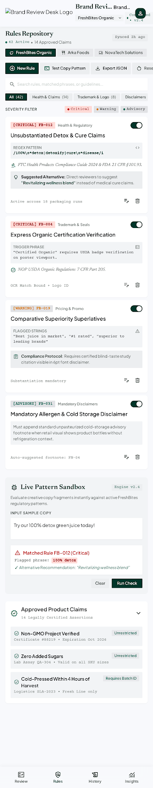

<div align="center">

# 
Brand Review Desk
### Choose a campaign. Review its flags. Record a decision.

An interactive prototype for checking campaign copy against brand rules.


</div>

## The whole workflow at a glance



**Start with a demo:** sample campaigns already have example rules and findings. No setup is needed.

**Review your own brand:** you must add your brand’s rules. A logo, product photo, or ad image does not tell the app what your brand allows.

> **Important:** uploaded-image OCR is simulated in this prototype. The app does not actually read text from your uploaded image. The scan, OCR text, confidence values, and resulting finding are examples.

## Try your first review

### 1. Start the app

Install [Node.js 18+](https://nodejs.org/), open a terminal in this project folder, and run:

```bash
npm install
npm run dev
```

Open **http://localhost:3000**.

### 2. Choose a sample campaign

Open **Review**, then select one of the campaign cards along the top. The app selects that campaign’s demo brand and shows its artwork, caption, and sample findings.

### 3. Understand and resolve a finding

Select a finding or its marker on the artwork to inspect the matched phrase and the rule explanation.

| Button | What happens |
| --- | --- |
| **Apply Suggestion** | Replaces the matched caption phrase when applicable and marks the finding resolved. |
| **Mark Reviewed** | Records a manual review decision. |
| **Dismiss w/ Note** | Opens a note dialog. Saving dismissal is not reliably implemented in this prototype yet. |
| **Undo Decision** | Reopens a resolved finding. |

Critical findings must be resolved before the approval button becomes available.

### 4. Approve and find the review

Click **Approve & Export Review Pack**. In the confirmation dialog, **Download Audit JSON** saves a file. Confirming adds the review to **History**.

## What about my own brand?

Go to **Rules** and add checks that your organization actually uses. For example:

- Terms or claims that must be flagged
- Required disclosures
- Approved product wording or facts
- A reason and suggested correction for each rule

Use **Test Copy Sandbox** to check a rule against sample text. You can change rules without setting up MongoDB; they are stored in this browser. The included brands and rules are examples, not legal or brand advice.

| Your goal | What to do |
| --- | --- |
| Explore the app | Choose a demo campaign. Existing demo rules are enough. |
| Check your own campaign copy | Add appropriate rules first, then review the caption and supplied text. |
| Upload a logo or brand photo | You can add it as campaign artwork, but it will not create a brand profile or rules. |

## What the other sections do

- **Rules** — search, add, edit, enable/disable, test, export, or reset the demo rules.
- **History** — view reviews saved in this browser.
- **Insights** — explore sample charts. They are not live organization analytics.

<details>
<summary><strong>See the app screen previews</strong></summary>

These are visual previews with sample content.

<p align="center"><strong>Review</strong><br></p>
<p align="center"><strong>Rules</strong><br></p>

</details>

## What is and isn’t real yet

| Works in the prototype | Demo or not connected yet |
| --- | --- |
| Browse sample brands and campaigns | OCR from an uploaded image (simulated) |
| Match provided caption/OCR text against configured rules | Learning brand rules from a logo or photo |
| Edit rules and try the copy sandbox | Shared team accounts or cross-device syncing |
| Record sample approvals and view History | React app syncing with the optional MongoDB API |

Rules and review history are saved in the current browser’s local storage. Uploaded campaigns last only for the current app session. Do not use prototype results as a real legal certification or production audit record.

## Developer notes

<details>
<summary><strong>Build, API setup, and project layout</strong></summary>

### Build the web app

```bash
npm run build
npm run preview
```

### Optional Express / MongoDB API

The repository includes an Express API, but it is separate from the React app. Starting it does **not** connect the web interface to MongoDB.

1. Copy `.env.example` to `.env`.
2. Set `MONGO_URI` to your MongoDB connection string. Keep `.env` private.
3. Optionally set `DB_NAME` (default `Brand_Review_Desk`) and `BACKEND_PORT=5001`.
4. Run `npm start`; check `http://localhost:5001/api/status`.

`npm run seed` replaces demo records in the configured database. Do not run it where existing data must be kept.

```text
src/components/   React screens, navigation, and dialogs
src/data/         Sample brands, campaigns, and reviews
src/utils/        Rule types and compliance matching
public/assets/    Campaign art, UI references, and README workflow image
server.js         Optional Express API
db.js             MongoDB connection and data operations
```

| Command | Purpose |
| --- | --- |
| `npm run dev` | Start the web app on port 3000 |
| `npm run build` | Build the frontend |
| `npm run preview` | Preview the production build |
| `npm start` | Start the optional API |
| `npm run seed` | Replace demo database records |

</details>

<div align="center">

**For a quick demo, choose a campaign. For your own brand, add your rules first.**

</div>
